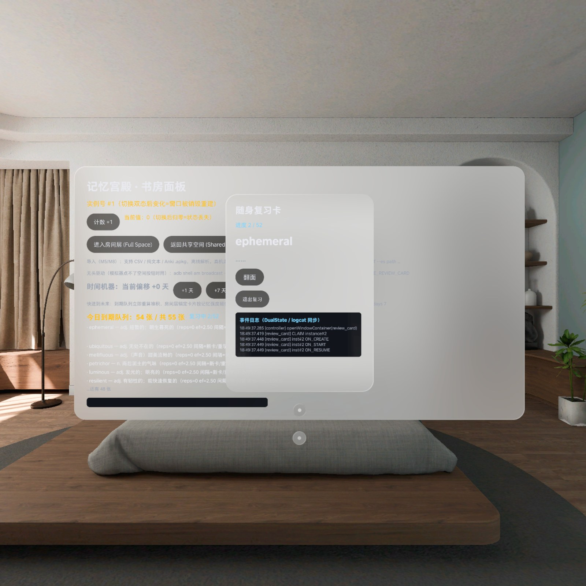

# 记忆宫殿 Memory Palace

> 把你的房间变成记忆宫殿 —— 单词贴在冰箱上，公式贴在书桌上。
> PICO Space Program 2026 · 最佳 PICO Spatial 空间应用赛道参赛作品 · Apache-2.0 开源



*上图为 PICO Emulator 6.1 实时录制（模拟器画面，非真机）。*

## 30 秒电梯陈述

1. 它把你的房间变成记忆宫殿 —— 单词贴在冰箱上，公式贴在书桌上。
2. 它按遗忘曲线算好你什么时候该回到哪件家具前，空间会主动提醒你。
3. 这是两千年记忆术第一次从"脑中想象"变成"眼睛看得见"。

记忆宫殿是一款 PICO MR 空间记忆应用：把 Anki 式卡片锚定到真实家具上，由 SM-2 改进版遗忘曲线调度复习，空间音频从卡片所在位置把你引导到正确的位置。

## 30 秒运行指南

> 前置：已安装 [PICO CLI](https://developer.picoxr.com/document/pico-cli/) 与 PICO Emulator

```bash
pico-cli emulator start --avd Pico_Emulator_6_1   # 1. 启动 PICO 模拟器
./gradlew installDebug                            # 2. 构建并安装
pico-cli app launch                               # 3. 启动应用
```

约 12 秒后三窗出现（模拟器实测，x86 转译；真机 arm64 原生更快）。首次启动会自动导入三套示例牌组（50 张），开箱即可复习。

## 功能矩阵

| 功能 | 状态 | 证据 |
|---|---|---|
| 三窗架构（书房看板 / 随身卡 / 房间层） | ✅ 已实测 | [双态结论](docs/DUAL-STATE-TEST.md) |
| 空间锚定（放卡 → 杀进程 → 重进 → 找回） | ✅ 已实测，恢复漂移 0.0m | [锚定结论](docs/ANCHOR-M2-TEST.md) |
| SM-2 改进版遗忘曲线调度 | ✅ 已实现，42 例单测全绿 | [算法说明](docs/ALGORITHM.md) |
| 看得见的遗忘（卡片随逾期褪色） | ✅ 已实测 | [时间机器结论](docs/M6-TIME-MACHINE-TEST.md) |
| 复习流（队列 → 翻面 → 自评 → 调度更新） | ✅ 已实测 | [复习流结论](docs/M4-REVIEW-FLOW-TEST.md) |
| CSV / TXT / Anki apkg 牌组导入 + 字段映射确认页 | ✅ 已实测 | [导入管线](docs/M5-IMPORT-PIPELINE-TEST.md) · [确认页](docs/M8-IMPORT-CONFIRM-TEST.md) |
| 三套预置示例牌组（语言 / 专业术语 / 生活常识） | ✅ 已实测 | [预置牌组](docs/M7-PRESET-DECKS-TEST.md) |
| 空间音频方位引导 | ✅ 模拟器已实测（声场方位待真机） | [实测结论](docs/M12-M14-TEST.md) |
| 头显本地到期提醒 | ✅ 模拟器已实测（弹窗与精确闹钟待真机） | [实测结论](docs/M12-M14-TEST.md) |
| 手势 + 手柄双路径交互 | ⚠️ 手柄路径已通，手势待真机 | 模拟器无法驱动空间按钮 |

**为什么有 ⚠️**：模拟器官方明示无法驱动 3D 空间按钮，空间交互与声场只能在真机验证。本项目坚持不伪造真机画面 —— 所有模拟器录屏都带角标标注。

## 架构

双态架构：**Shared Space** 跑 WindowContainer 多窗口管理（书房看板 + 随身卡），**Full Space（Stage）** 跑空间锚定复习。

```
┌───────────────────────── PICO OS 6 ─────────────────────────┐
│  Shared Space                    Full Space (Stage)          │
│  ┌──────────────┐ ┌───────────┐   ┌───────────────────────┐  │
│  │ 书房 Window   │ │ 随身卡     │   │ 房间层：锚定卡片 +       │  │
│  │ Container     │ │ Container │   │ 空间音频 + 手势          │  │
│  └──────┬───────┘ └─────┬─────┘   └───────────┬───────────┘  │
│         └───────────────┴─────────────────────┘              │
│                         │                                    │
│              spatial/（SDK 适配层）                            │
│                         │                                    │
│         core/（数据模型 + SM-2 + 记忆强度，纯 Kotlin 零 SDK）    │
│                         │                                    │
│         data/（Room 持久化 + CSV/apkg 导入管线）                │
└──────────────────────────────────────────────────────────────┘
```

**关键约束**：`core/` 模块不 import 任何 PICO SDK，也不 import `android.*` —— 调度算法与导入管线是纯 JVM，可离线单测，CI 里跑（42 例）。这条约束由 CI 静态检查强制（`.github/workflows/ci.yml`）。

### 目录

| 路径 | 内容 |
|---|---|
| `core/` | 纯 JVM：卡片模型、SM-2 调度器、记忆强度可视化、CSV/TXT/apkg 解析器 |
| `app/` | Android/PICO 层：三窗 UI、锚定场景、复习会话、导入服务、空间音频 |
| `data/` | Room 持久化与导入管线（app 内） |
| `spatial/` | Spatial SDK 适配层预留 |
| `docs/` | 实测结论、算法、设计规范、评分口径、竞品调研 |
| `scripts/gen_audio.py` | 生成空间提示音资产（可复现） |

## 调度算法

SM-2 改进版为主路径（**可解释、可单测**），FSRS 保留演进位。

| 自评 | 间隔 | EF 变化 |
|---|---|---|
| 忘了 | 10 分钟后重学，`repetitions` 清零 | 下调（公式值，下限 1.3） |
| 记住了 | 1 天 → 6 天 → 之后 × EF | 不变 |

遗忘程度直接驱动卡片外观：**逾期时长 ÷ 当前间隔 = 褪色程度**，逾期越久卡片越暗、标签从"记得牢"变成"正在遗忘"再变成"快忘了"。这就是"看得见的遗忘曲线"。

详见 [docs/ALGORITHM.md](docs/ALGORITHM.md)。

## 空间音频

提示音不是屏幕提示，是**从卡片所在位置发出来的空间音源**：三个语义音（到期 / 放置确认 / 复习完成）挂在锚定卡片实体上，由 PICO 空间音频管线按实体世界坐标做空间化渲染。

这样"走到冰箱前声音在左边"和"卡片贴在冰箱上"用的是同一套坐标系 —— 方位感来自真实锚点位置，不是手写的声像 pan。

提示音资产由 `scripts/gen_audio.py` 程序化生成（48kHz / 16-bit 单声道 WAV），可复现、可审计。

## Vibe Coding 工作流

本项目采用 **PICO CLI + AI 编程助手** 的实际开发工作流：

- `pico-cli doctor` 诊断环境、`pico-cli emulator` 管理模拟器生命周期、`pico-cli app` / `pico-cli log` / `pico-cli capture` 覆盖安装、日志、截图
- AI 助手负责模块骨架、单测生成与文档同步；人负责架构决策、空间交互体验与最终验收
- commit 记录如实反映人机协作过程，**不做"全人工风格"伪装** —— 评委对照 README 翻 git log 时两者一致，才是加分而不是穿帮

### 无头测试通道

模拟器驱动不了 3D 空间按钮，所以每个可交互动作都配了 adb 广播入口（保留作自动化测试用，现场演示走真实 UI）：

```bash
adb shell am broadcast -a com.memorypalace.dualstate.OPEN_STAGE       # 开房间层
adb shell am broadcast -a com.memorypalace.anchor.PLACE --ef x 0 --ef y 1.2 --ef z -1.5 --es front "abandon"
adb shell am broadcast -a com.memorypalace.review.START               # 开始复习
adb shell am broadcast -a com.memorypalace.review.GRADE --es grade remember
adb shell am broadcast -a com.memorypalace.clock.SET_OFFSET --el days 7  # 时间机器
adb shell am broadcast -a com.memorypalace.audio.PLAY --es cue cue_due  # 空间提示音
adb shell am broadcast -a com.memorypalace.notify.SCHEDULE   # 排到期提醒
```

## 空间能力矩阵

| PICO Spatial SDK 能力 | 本项目用法 | 官方文档 |
|---|---|---|
| WindowContainer（Planar） | 书房看板、随身卡窗口 | [空间容器与空间状态](https://developer.picoxr.com/document/spatial-sdk/learn-about-spatial-containers-and-space-states/) |
| Stage（Full Space） | 房间层沉浸复习 | 同上 |
| WorldTrackingManager 空间锚定 | 卡片绑定真实家具（每应用上限 1024 锚点，检索半径 5m） | Spatial SDK 锚定文档 |
| ObjectAudioComponent 空间音频 | 从锚点位置发提示音（距离平方反比衰减） | [空间音频示例](https://developer.picoxr.com/document/spatial-sdk/spatial-audio-sample/) |
| 手势追踪 | 捏合抓取/翻卡（手柄为主路径） | [手部追踪](https://developer-cn.picoxr.com/document/spatial-sdk/hand-tracking/) |
| PICO Emulator | 全流程无真机开发与录屏 | [PICO Emulator](https://developer-cn.picoxr.com/document/spatial-toolkit/learn-about-pico-emulator/) |

## 文档

| 文档 | 内容 |
|---|---|
| [docs/ALGORITHM.md](docs/ALGORITHM.md) | SM-2 调度器与记忆强度可视化的完整规则与边界 |
| [docs/DESIGN.md](docs/DESIGN.md) | 设计规范：色板 / 字号 / 间距 token 与褪色视觉规则 |
| [docs/SCORING.md](docs/SCORING.md) | 评分维度的自评口径与每个数字的来源（含诚实声明） |
| [docs/COMPETITORS.md](docs/COMPETITORS.md) | XR 同类竞品对比与差异化结论 |
| [docs/DEMO-RUNBOOK.md](docs/DEMO-RUNBOOK.md) | 三分钟现场演示操作单（给没碰过应用的操作员） |
| [docs/DUAL-STATE-TEST.md](docs/DUAL-STATE-TEST.md) | 双态切换与窗口生命周期实测结论 |
| [docs/ANCHOR-M2-TEST.md](docs/ANCHOR-M2-TEST.md) | 锚定闭环实测（含恢复漂移数据） |
| [docs/M4–M8-*-TEST.md](docs/) | 复习流 / 导入管线 / 时间机器 / 预置牌组 / 确认页 实测记录 |
| [docs/VIDEO-STORYBOARD.md](docs/VIDEO-STORYBOARD.md) | 演示视频分镜（150s 五幕） |
| [docs/ITERATION.md](docs/ITERATION.md) | 迭代记录：全新项目声明与里程碑日志 |

## 路线图

- **2026-11-07**：仓库初始化；M1 三窗空壳（双态生命周期实测封板）
- **2026-11-07**：M2–M8 集中落地 —— 锚定闭环、数据层、复习流、导入管线、时间机器、预置牌组、导入确认页
- **2026-11-09**：M12 冷启动占位页；M13 空间音频方位引导 + 记忆强度下沉 core（42 例单测全绿）；M14 头显本地到期提醒
- **11/10–11/13**：XR 同类竞品调研 ≥5 款；README / 算法 / 设计 / 评分文档定稿
- **11/14–11/22**：真机借测窗口（空间交互唯一验证手段）；锚定最小闭环复测
- **11/23–11/29**：复习流打磨；11/25 提交 v0.1 占位；11/28 起每日真实使用记录
- **11/30–12/7**：空间音频真机验证；视觉打磨；设计规范数字化
- **12/8–12/16**：视频拍摄剪辑、文档定稿；**12/16 24:00 最终提交**
- **12/26**：北京大钟寺决赛路演

## License

[Apache-2.0](LICENSE) © 2026 Memory Palace contributors
