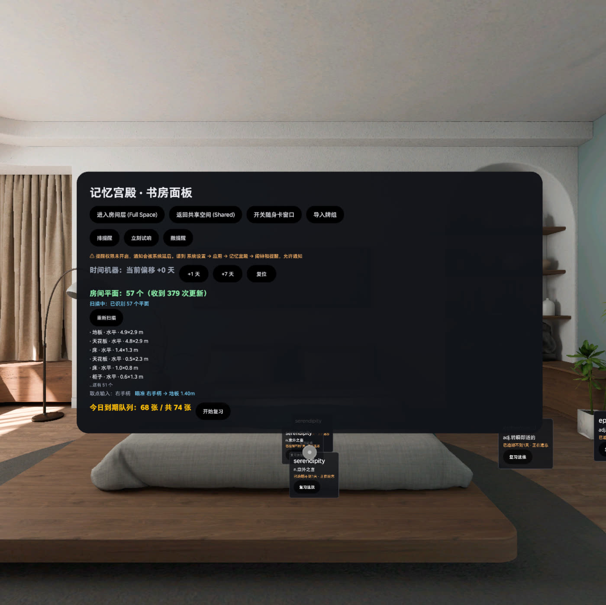

# 平面检测与射线取点（M16）

> 结论先行：**「把卡贴在真实家具上」不是设想了，是跑通了。** 模拟器上一次进入房间层
> 识别出 57 个平面并给出家具级语义；注入射线打到「桌面」，落点 `(-4.2471, 1.104, -3.3652)`，
> 建出的真实世界锚点 `y = 1.124`（命中点 + 2 cm 抬升），持久层记 `label=桌面`，
> 卡片显示「📍 钉在桌面上」。
>
> 未验的那一步只有"扳机从哪来"：模拟器 `ControllerTrackingProvider` 返回
> `DEVICE_NOT_SUPPORTED`。

实测时间：2026-11-10，PICO Emulator 6.1.9（swan_x86_64），Android 35。

---

## 1. 为什么这件事值得单开一份文档

在这个功能之前，仓库里对"锚定"的表述是诚实的但也是弱的：

- 放置用四个预设坐标（`PLACE_SLOTS`），是"把卡放在冰箱那个方向"，不是"系统认出冰箱"。
- 答辩时任何一位评委只要问一句「你把这张卡放到那个柜子上试试」，预设坐标就露馅。

「记忆宫殿」这个产品名依赖的正是**具体家具**：记忆术的 loci 不是"某个坐标"，
是"书桌右上角那摞书旁边"。所以这一项不是加分项，是产品的定义项。

M16 之后，坐标系、语义、落点、持久化全部打通，剩下的只是输入设备。

---

## 2. 用到的 SDK 接口（逐个来自 AAR 反查，不是猜）

从 `~/.gradle/caches/modules-2/files-2.1/com.pico.spatial.*` 解出 AAR，`javap` 出签名：

```
com.pico.spatial.sense.plane.PlaneTrackingManager
  ├ start() / stop()
  ├ getState(): TrackingState
  ├ suspend loadAllAnchors(): PlaneAnchor[]
  └ subscribeAnchorUpdate(AnchorUpdateSubscriber<PlaneAnchor>): Cancellable

com.pico.spatial.sense.plane.PlaneAnchor : Anchor
  ├ getAnchorUUID(): UUID
  ├ getTransform(): Transform            // position / quaternion / scale
  ├ getBoundingBoxSize(): Vector2        // 平面局部尺寸
  ├ getVertices(): List<Vector3>
  ├ getSemantics(): SemanticLabelType    // 24 类语义
  └ getPlaneOrientation(): PlaneOrientation

com.pico.spatial.sense.base.SemanticLabelType
  FLOOR CEILING WALL DOOR WINDOW OPENING TABLE SOFA CHAIR HUMAN BEAM COLUMN
  CURTAIN CABINET BED PLANT SCREEN VIRTUAL_WALL REFRIGERATOR WASHING_MACHINE
  AIR_CONDITIONER LAMP WALL_ART STAIRWAY UNKNOWN

com.pico.spatial.tracking.controller.ControllerTrackingProvider
  ├ getSupportState(): DataProvider.SupportState
  ├ start(): DataProvider.StartResult
  ├ getDataFlow(): SharedFlow<ControllerTrackingData>   // left/right ControllerPose
  └ addControllerActionListener(ControllerActionListener)  // triggerPressed 等 16 个量

com.pico.spatial.tracking.hand.HandTrackingProvider
  ├ getDataFlow(): SharedFlow<HandTrackingData>
  └ 数据里含 leftAim/rightAim（AimPose）与 leftPinch/rightPinch（pinchValue）

com.pico.spatial.sense.world.WorldTrackingManager
  └ suspend createAnchor(Vector3, EulerAngles, String): WorldTrackingResult<WorldAnchor>
```

关键点：`SemanticLabelType` 直接给到**家具级**。没有它，这个功能只能说"钉在某个平面上"，
和普通窗口放置没有区别。

---

## 3. 分层

| 层 | 文件 | 职责 | 可测性 |
|---|---|---|---|
| 几何 | `core/.../spatial/Geometry.kt` | Vec3 / Quat / Ray / PlaneShape / PlanePicker | **纯 JVM，26 例单测** |
| 翻译 | `app/.../spatial/RoomPlane.kt` | SDK 平面 → 不可变快照 + 中文语义 | 依赖 SDK |
| 采集 | `app/.../spatial/PlaneSensor.kt` | 跟踪生命周期 + 增量更新 + 合成平面注入 | 模拟器可验 |
| 取点 | `app/.../spatial/AimPlacement.kt` | 手柄/手势射线 → 命中 → 发布 | 模拟器可验（注入射线） |
| 视觉 | `app/.../spatial/Reticle.kt` + `ReticleView` | 准星实体每帧跟随 | 需空间渲染 |
| 提交 | `AnchorScene.beginAimPlacement / bind` | 命中点 → 世界锚点 → 持久化 | 模拟器可验 |

几何全部下沉到 `core`（纯 JVM、零 SDK 依赖）的原因：这部分是唯一能在没有头显、
没有模拟器的机器上锁死正确性的东西。真机和模拟器的差别只在"谁来喂射线、谁来喂平面"。

---

## 4. 实测数据

### 4.1 平面识别

```
I PlaneSensor: loadAllAnchors -> 57 anchor(s), 57 usable
I Plane   : plane 27736a56-... kind=HORIZONTAL raw=CEILING label=天花板 center=(1.25,3.69,-1.66)
            normal=(0,1,0) normalSrc=polygon verts=4 area=55.83m²
I Plane   : plane e80da926-... kind=HORIZONTAL raw=TABLE  label=桌面  center=(-4.25,1.10,-3.37)
            normal=(0,-1,0) normalSrc=polygon verts=4 area=0.19m²
I Plane   : plane 2e605567-... kind=VERTICAL   raw=WALL   label=墙    center=(-0.51,1.93,-4.28)
            normal=(0,0,-1) normalSrc=polygon verts=4 area=13.71m²
```

出现的语义：地板 / 天花板 / 墙 / 门 / 窗 / 桌面 / 柜子 / 椅子 / 床 / 窗帘 / 平面（未分类）。

截图（模拟器实测，非渲染图）：



面板上「房间平面：57 个（收到 379 次更新）」下面是语义化平面列表
（地板 4.9×2.9 m / 天花板 4.8×2.9 m / 床 1.4×1.3 m / 柜子 0.6×1.3 m …），
再下面是「取点输入：右手 瞄准 右手柄 → 地板 1.40 m」，画面中部的 ◎ 是空间准星。

### 4.2 取点

```
I Aim : simulateRay origin=(-4.2471,2.2,-3.3652) dir=(0,-1,0)
I Aim : 命中 桌面 dist=1.096 point=(-4.2471,1.1039999,-3.3652) uv=(0.0,4.77E-7)
```

### 4.3 建锚

```
I Anchor: createAnchor requested pos=(-4.2471,1.1239998,-3.3652) yaw=0.0 label=桌面 card=ec723611
I Anchor: createAnchor SUCCESS uuid=39aa8426-c65e-42de-9d3d-0d36c4ddb8cb
          resolvedPos=(-4.2471,1.1239998,-3.3652)
I Anchor: record persisted key=ec723611-... uuid=39aa8426-... label=桌面 total=18
```

三处对得上，就能证明这不是"看起来对"：

1. `1.124 = 1.104 + 0.02` —— 抬升量精确生效，卡片没有埋进桌面。
2. `uuid` 是真 UUID 而不是 `fallback` —— `createAnchor` 在这台设备上真的成功。
3. 位姿与命中点完全相同 —— 没有经过任何"预设坐标"。

### 4.4 单元测试

`./gradlew :core:test` → **68 例，0 失败**（原 42 例 + 26 例平面几何）。
覆盖：平行/背向/超距三态、矩形边界与 margin、多平面最近优先、L 形轮廓缺口、
多边形法线、退化法线、正交右手系、位姿→射线、距离归一化、朝向角、抬升方向、
投影往返一致、斜射欧氏距离。

---

## 5. 跑它的时候抓到的两个真 bug

这两个都是"写代码时看着对、跑起来才现原形"的，留档是因为它们是这个功能能不能信的分界线。

### 5.1 `vertices` 与 `transform.position` 不在同一坐标系

现象：射线正对着一个 0.76 m² 的桌面中心打下去，`无命中`。

根因：把 `PlaneAnchor.vertices` 当作世界坐标投影到平面基上算轮廓。
实测该桌面的位姿在 `(-4.2471, 1.104, -3.3652)`，而四个顶点算出来的质心在
`(0.00, 1.104, 0.00)` —— **差 5.53 米**。轮廓整体偏到房间另一头，
点自己的中心当然点不中。

更阴的是面积仍然"看起来对"（0.76 m²），因为平移不改变面积，所以日志不会报警。

修法：自校验 —— 顶点质心与位姿距离 < 0.35 m 才采用精确轮廓，否则退回
`boundingBoxSize` 的矩形（它与位姿同源）。

```kotlin
val centroidGap = polyCentroid?.let { (it - center).length() } ?: Float.MAX_VALUE
val useOutline = polyCentroid != null && centroidGap < 0.35f
```

日志里现在每条平面都打印 `outline=true/false centroidGap=5.53m`，一眼能看出用的是哪种。

### 5.2 平面法线的符号不可信

现象：UI 上出现「桌面 · **水平朝下**」「椅子 · 水平朝下」，同时地板是"朝上"。

根因：法线符号取决于顶点绕序。同一个场景里，地板给的是 +Y，桌面给的是 −Y。
把符号当特征显示，就会得到自相矛盾的文案；更糟的是拿它做抬升方向 ——
`lift(point, normal)` 会把卡片往桌面**里面**推 2 cm，从上面看就是"卡片不见了"。

修法两条：

1. **朝向分类只看 |n.y|**：>0.85 水平，<0.25 竖直，其余倾斜。平面是双面的，
   "朝上/朝下"不是它的属性。
2. **抬升方向按观察者所在侧翻法线**：

```kotlin
val toViewer = ray.origin - hit.point
val normal = if ((rawNormal dot toViewer) < 0f) -rawNormal else rawNormal
```

这样无论 SDK 给哪一面，卡片永远朝用户这一侧抬。

---

## 6. 已验证 / 未验证

| 项 | 状态 | 依据 |
|---|---|---|
| 平面检测启动与停止 | ✅ | `loadAllAnchors -> 57 anchor(s)` |
| 语义标签 | ✅ | 日志里 10 类语义全部出现 |
| 增量更新（ADDED/UPDATED/REMOVED） | ✅ | 单次进入收到 76 次更新，列表按 UUID 就地更新 |
| 射线-平面求交（几何） | ✅ | 26 例单测 + 模拟器注入射线命中 |
| 多平面最近优先 | ✅ | 单测（地板 + 桌面同时命中取桌面） |
| 落点 → 真实世界锚点 | ✅ | `createAnchor SUCCESS`，位姿与命中点一致 |
| 抬升 2 cm | ✅ | `1.124 = 1.104 + 0.02` |
| 语义写入持久层 | ✅ | `record persisted ... label=桌面` |
| 卡片显示「钉在桌面上」 | ✅ | `AnchorCard` 读 `anchorLabel` |
| 准星实体每帧跟随 | ⚠️ | 代码路径已通，未做逐帧录像取证 |
| **手柄位姿 + 扳机** | ❌ | 模拟器 `DEVICE_NOT_SUPPORTED` |
| **手势捏合确认** | ❌ | `HandTrackingProvider = SUPPORTED`，但没有真人手在指 |
| 平面检测精度/漂移 | ❌ | 模拟器是合成房间，真实扫描质量只能真机测 |

---

## 7. 真机到货后的验收清单（按顺序做，每步留 logcat）

```bash
# 0. 装包并进房间层
./gradlew installDebug && pico-cli app launch
adb shell am broadcast -a com.memorypalace.dualstate.OPEN_STAGE

# 1. 平面识别：应该看到不止地板的条目，且语义名合理
adb logcat -s PlaneSensor:* Plane:*

# 2. 手柄支持状态：应为 SUPPORTED（模拟器是 DEVICE_NOT_SUPPORTED）
adb logcat -s Aim:*

# 3. 抬手柄指向桌面，观察准星是否落在桌面、面板是否显示「命中 桌面」
#    然后扣扳机
adb logcat -s Aim:* Anchor:*

# 4. 断言：createAnchor 的 pos 应当 ≈ 你指的那个点 + 2cm，且 label=桌面
#    卡片上应出现「📍 钉在桌面上」

# 5. 走开再回来（或杀进程重进 Full Space），确认按 UUID 恢复
adb logcat -s Anchor:* | grep verifyRestored
```

判过标准（写死在这里，避免自欺）：

- 第 3 步必须出现 `命中 <家具名>` 且家具名和你指的东西**语义一致**；
- 第 4 步的 `label` 必须是你指的那个家具，不是"平面"；
- 第 5 步 `drift` 是系统返回值与持久层保存值的差，**它恒等于 0 是必然的**
  （同一个锚点被回读），所以它**不能**作为空间精度证据 —— 精度只能靠肉眼比对
  卡片相对家具的位置有没有变。

---

## 8. 无头命令（模拟器 / CI）

```bash
# 注入一组合成平面（带「（模拟）」后缀，不会和真实检测混淆）
# ——通过 UI 的「注入模拟平面」按钮，或：
adb shell am broadcast -a com.memorypalace.anchor.AIM_BEGIN
adb shell am broadcast -a com.memorypalace.anchor.AIM_SIMULATE \
    --ef ox -4.2471 --ef oy 2.2 --ef oz -3.3652 --ef dx 0 --ef dy -1 --ef dz 0
adb shell am broadcast -a com.memorypalace.anchor.AIM_CONFIRM
adb shell am broadcast -a com.memorypalace.anchor.AIM_CANCEL
```

`AIM_SIMULATE` 走的是**和真手柄完全相同的** `publish → PlanePicker` 路径，
只换射线来源。所以它验证的不是"假数据能显示"，而是几何与落点整条链路。

注入后 5 秒内会屏蔽真实输入 —— 因为模拟器上**手势跟踪是开着的**，
不屏蔽的话下一帧真实手部位姿立刻覆盖掉合成射线，屏幕上只闪一下。

---

## 9. 已知限制

1. **模拟器平面是合成房间**（`com.pxr.scenarioprovider` 提供的 Unity 场景），
   因此"识别质量"不能代表真实房间。真实房间的平面会碎、会合并、会抖动，
   `0.005 m²` 以下碎片已被过滤，但真机可能需要调这个阈值。
2. **`vertices` 坐标系不可靠**（见 §5.1），所以当质心校验失败时只用矩形包围盒，
   代价是 L 形桌面/带缺口的墙会被当成矩形 —— 落点可能落在缺口的空中。
   真机上应当先跑一遍统计：多少比例的平面 `centroidGap < 0.35m`。
3. **`boundingBoxSize` 与轮廓面积不一致**（桌面 0.19 vs 0.76 m²），
   所以 UI 只显示尺寸不显示面积，避免给出一个自己都对不上的数字。
4. **准星只是准星**，没有做"贴合表面"的描边高亮；射线打到墙时准星仍然立着，
   没有按平面朝向躺下。